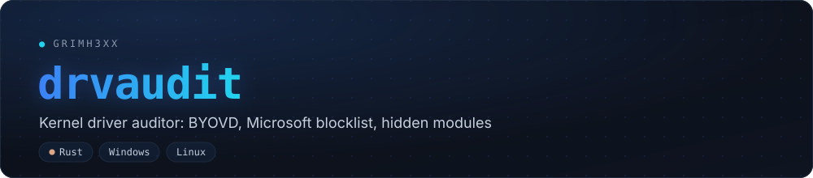

[](https://github.com/grimh3xx/drvaudit/actions)
[](LICENSE)


**A read-only kernel driver auditor for BYOVD and rootkit hunting, in Rust.**
drvaudit enumerates the drivers loaded in the running kernel, or scans driver
files on disk. It matches each one against **LOLDrivers** and **Microsoft's
recommended vulnerable driver blocklist** using both the file hash and the
**Authenticode hash**. It then checks signatures, load locations and taint
flags, finds **hidden Linux modules** by comparing two kernel views, and
reports drift against a baseline. It never loads, unloads or modifies a driver.

## Detections

| ID | Severity | Detection |
|---|---|---|
| DRV-001 | critical | Driver classified **malicious** by LOLDrivers |
| DRV-002 | high | **Known-vulnerable** signed driver (BYOVD), with CVEs |
| DRV-003 | high | On the Microsoft blocklist by Authenticode SHA-1/SHA-256 |
| DRV-004 | medium | On the Microsoft blocklist by OriginalFilename + version window + **signer CA, verified by TBS hash** |
| DRV-005 | high/medium | Driver outside the driver store with no embedded signature |
| DRV-006 | medium | Unsigned Linux kernel modules (appended signature checked inside `.ko`, `.ko.xz`, `.ko.zst` and `.ko.gz`) |
| DRV-007 | high | Module force-loaded (taint `F`) |
| DRV-008 | high/medium | Driver loaded from a user-writable or non-standard path |
| DRV-009 | medium | Loaded driver whose file was deleted |
| DRV-010 | critical | **Module hidden from `/proc/modules`**: it has a sysfs kobject but is not on the module list (the classic LKM rootkit technique) |
| DRV-011/012/017 | medium/high/info | New / changed / removed since the baseline |
| DRV-013 | info | Threat-intel feeds not loaded |
| DRV-015/016 | info | Catalog-signed inbox drivers; out-of-tree modules |

### Why the Authenticode hash matters

Blocklist and LOLDrivers rules key on the **Authenticode digest**: the image
hashed without its checksum, its security directory and its certificate table.
Re-signing a driver or appending data changes the file hash but leaves the
Authenticode digest unchanged. drvaudit computes it in-tree and matches
`Get-AppLockerFileInformation` byte for byte.

Blocklist rules keyed on filename are bound to a signing CA through
`<Signer><CertRoot Type="TBS">`. drvaudit hashes the TBSCertificate of every
certificate in the driver's PKCS#7 chain and requires a match. An inbox
`monitor.sys` from Microsoft therefore does not trip the rule written for
IOBit's `Monitor.sys`.

## Usage

```sh
drvaudit update                     # fetch LOLDrivers + MS blocklist into the cache
drvaudit                            # audit loaded drivers / modules
drvaudit -l                         # list every driver
drvaudit scan C:\Windows\System32\drivers
drvaudit scan /lib/modules/$(uname -r)
drvaudit --save-baseline base.json  # snapshot
drvaudit --baseline base.json       # drift since snapshot
drvaudit --json | --sarif           # machine-readable output
```

Audits never touch the network. Only `update` downloads, from
`loldrivers.io` and `aka.ms/VulnerableDriverBlockList`. Feeds are cached in
`%LOCALAPPDATA%\drvaudit` or `~/.cache/drvaudit` (override with
`DRVAUDIT_CACHE`, `--loldrivers` and `--blocklist`).

Windows enumeration uses `NtQuerySystemInformation(SystemModuleInformation)`.
Linux enumeration reads `/proc/modules`, cross-checks it against
`/sys/module/*/initstate`, and resolves files through `modules.dep`.

## Build

```sh
cargo build --release
cargo build --release --target x86_64-pc-windows-gnu
```

MIT © grimh3xx
